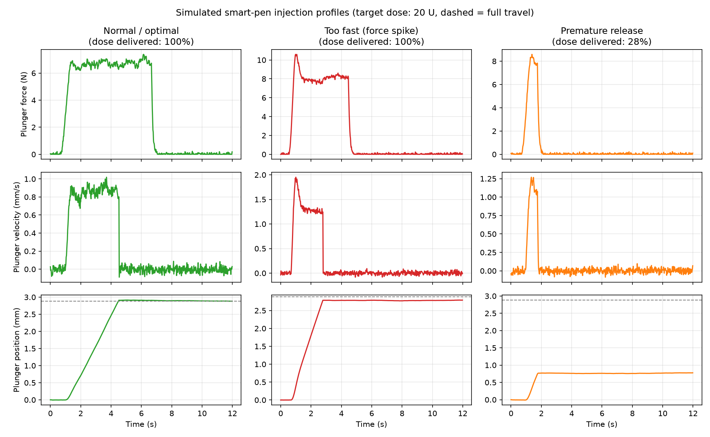

# Smart Insulin Pen: Medication Delivery Monitoring Simulator

> **Work in progress: Day 1 of a 30-day public build challenge.**

An educational, software-only project: an interactive, visual simulator of how
an insulin pen works and fails. It simulates plunger force and velocity using
fluid mechanics, and trains a machine-learning model to flag faulty injections.

> **Disclaimer:** This is an educational simulator. It is **not a medical
> device**, has not been validated on real patients or real pens, and must
> never be used to guide insulin dosing or any medical decision.

## Current status
- [x] Phase 1: synthetic data simulator (`simulate_injections.py`)
- [x] Phase 2: classifier with cross-validation (`train_model.py`)
- [ ] Physics model v2, more fault types, literature validation, interactive app

See [`docs/project_goal.md`](docs/project_goal.md) for the goal and the
definition of done, and [`docs/devlog.md`](docs/devlog.md) for daily progress.

## Quick start
```bash
pip install -r requirements.txt
python simulate_injections.py
python train_model.py
```



## Known limitations (so far)
- All data is synthetic, and labels come from my own generator, so high
  accuracy shows the pipeline works, **not** that it works on real pens. No real-device data is used in this project.
- Simulation parameters are assumptions, not yet checked against published
  sources or ISO 11608.
